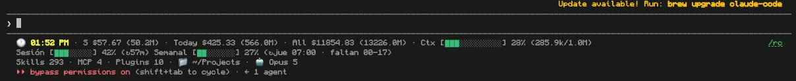

# Cost Dashboard

Real-time token, cost, context and rate-limit dashboard for the Claude Code statusline.



```
🕐 02:07 PM · S $39.32 (39.3M) · Today $526.65 (665.0M) · All $1954.88 (3323.0M) · Ctx [███░░░░░░░░░] 27% (267.2k/1.0M)
Session [██░░░░░░] 29% (↻1h 57m) Weekly [██░░░░░░] 25% (↻thu 08:07 · left 00-17)
Skills 262 · MCP 8 · Plugins 9 · 📁 ~/Projects/web · 🤖 Opus 5 · 🎚️ high · ⚡ · 🧠 · Cache 97% · ⎇ master* 1↓0↑
```

## Views

**Everything on** — subscription plan, inside a git repo, fast mode and thinking enabled:

```
🕐 02:07 PM · S $39.32 (39.3M) · Today $526.65 (665.0M) · All $1954.88 (3323.0M) · Ctx [███░░░░░░░░░] 27% (267.2k/1.0M)
Session [██░░░░░░] 29% (↻1h 57m) Weekly [██░░░░░░] 25% (↻thu 08:07 · left 00-17)
Skills 262 · MCP 8 · Plugins 9 · 📁 ~/Projects/web · 🤖 Opus 5 · 🎚️ high · ⚡ · 🧠 · Cache 97% · ⎇ master* 1↓0↑
```

**API-key billing, outside a repo** — the limits line disappears (the account exposes none), `⚡`/`🧠` are hidden because they are off, and git shows `no repo` instead of a stale branch:

```
🕐 02:07 PM · S $12.04 (9.1M) · Today $526.65 (665.0M) · All $1954.88 (3323.0M) · Ctx [█░░░░░░░░░░░] 8% (62.9k/1.0M)
Skills 293 · MCP 4 · Plugins 10 · 📁 ~/Projects · 🤖 Sonnet 5 · 🎚️ medium · ⎇ no repo
```

**Spanish, 24-hour clock, third line off** (`{"locale":"es","clock24h":true,"sections":{"counters":false}}`):

```
🕐 14:07 · S $39.32 (39.3M) · Hoy $526.65 (665.0M) · Total $1954.88 (3323.0M) · Ctx [███░░░░░░░░░] 27% (267.2k/1.0M)
Sesión [██░░░░░░] 29% (↻1h 57m) Semanal [██░░░░░░] 25% (↻jue 08:07 · faltan 00-17)
```

**Minimal** (`{"sections":{"costs":true,"context":true,"clock":false,"limits":false,"counters":false}}`):

```
S $39.32 (39.3M) · Today $526.65 (665.0M) · All $1954.88 (3323.0M) · Ctx [███░░░░░░░░░] 27% (267.2k/1.0M)
```

## What it shows

**Line 1** — clock, spend for the current session / today / all time (tokens in parentheses), and the context window bar.

**Line 2** — plan limits: 5-hour session window and the 7-day window, each with a bar, a percentage, and when it resets (`↻`). The weekly entry also shows a `dd-hh` countdown.

**Line 3** — available skills, MCP servers and enabled plugins for the current project, working directory, active model, effort level, fast mode (`⚡`) and thinking (`🧠`) when enabled, prompt-cache hit ratio, and git branch with dirty marker and ahead/behind counts.

Sections with no data disappear instead of rendering placeholders — `⚡` and `🧠` only appear when active, and limits are omitted when the account exposes none (API-key billing, for example).

## How it works

Claude Code passes a JSON payload to the statusline command on every render. Live values — context window, rate limits, cache stats, model, effort — come straight from that payload.

Historical spend is computed by scanning the session transcripts under `~/.claude/projects/**/*.jsonl`, summing `usage` per model per day, and pricing it with the table below. Parsed results are cached in `~/.claude/.cost-dashboard-cache.json` and a transcript is re-read only when its file size changes, so a render stays fast even with hundreds of sessions.

## Install

```
/plugin marketplace add Koder-SpA/claude-mods
/plugin install cost-dashboard@koderspa
```

Then run `/dashboard-setup` and open a new session.

Manual alternative — add to `~/.claude/settings.json`:

```json
{
  "statusLine": {
    "type": "command",
    "command": "node \"/absolute/path/to/cost-dashboard/scripts/statusline.mjs\""
  }
}
```

Requires Node 18+. No dependencies, no network calls, no telemetry — everything is read from local files.

## Configuration

Optional, at `~/.claude/cost-dashboard.json`:

```json
{
  "locale": "es",
  "clock24h": true,
  "sections": {
    "clock": true,
    "costs": true,
    "context": true,
    "limits": true,
    "counters": true,
    "git": true
  },
  "barWidth": { "context": 12, "limits": 8 },
  "pricing": {
    "claude-opus-5": { "in": 15, "out": 75, "cw5": 18.75, "cw1h": 30, "cr": 1.5 }
  }
}
```

| Key | Default | Meaning |
|---|---|---|
| `locale` | `en` | `en` or `es` for labels |
| `clock24h` | `false` | 24-hour clock instead of AM/PM |
| `sections.*` | all `true` | Turn individual sections off |
| `barWidth.context` | `12` | Width of the context bar in characters |
| `barWidth.limits` | `8` | Width of each limit bar |
| `pricing.<model-id>` | built-in | USD per 1M tokens: `in`, `out`, `cw5` (5m cache write), `cw1h` (1h cache write), `cr` (cache read) |

Unknown model IDs fall back to the `_default` entry.

## Accuracy

Costs are **estimates**. They are computed from token counts in the transcripts multiplied by published per-model rates — not from what your account was actually billed. On a Max or Pro subscription the dollar figure is a usage-equivalent, not a charge. Keep the pricing table current, or override it in your config, if the numbers matter to you.

Plan limits (`Session`, `Weekly`) come from Claude Code itself and are exact. They are absent for API-key billing.

## Uninstall

Remove the `statusLine` key from `~/.claude/settings.json`, then `/plugin uninstall cost-dashboard@koderspa`. The cache file at `~/.claude/.cost-dashboard-cache.json` can be deleted safely.

## License

MIT
